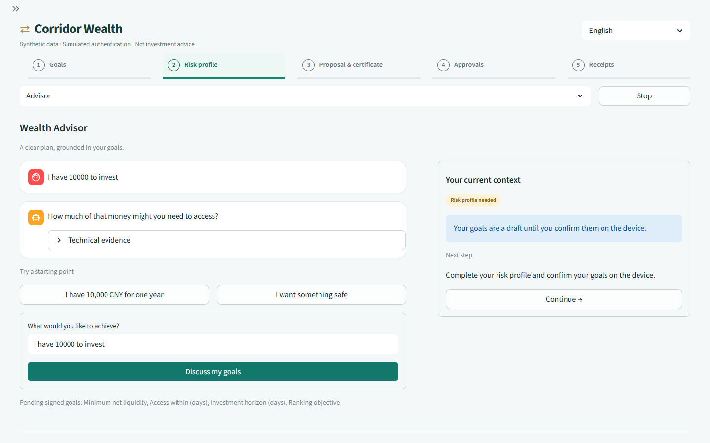
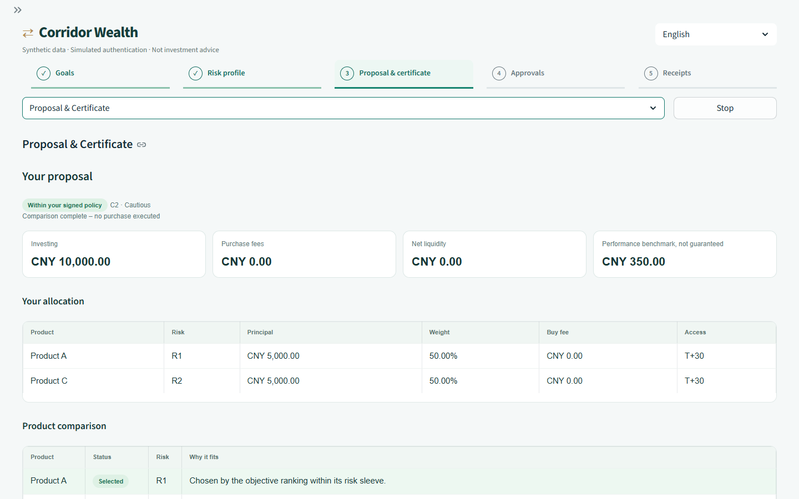
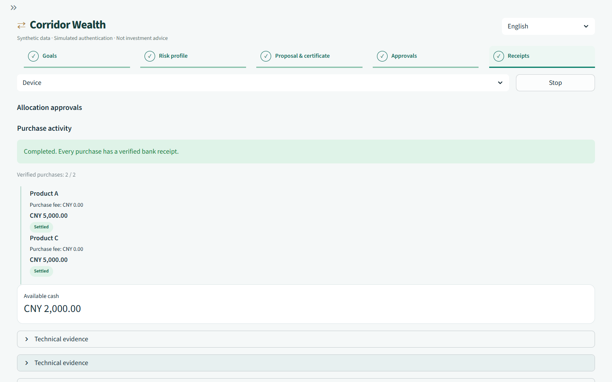
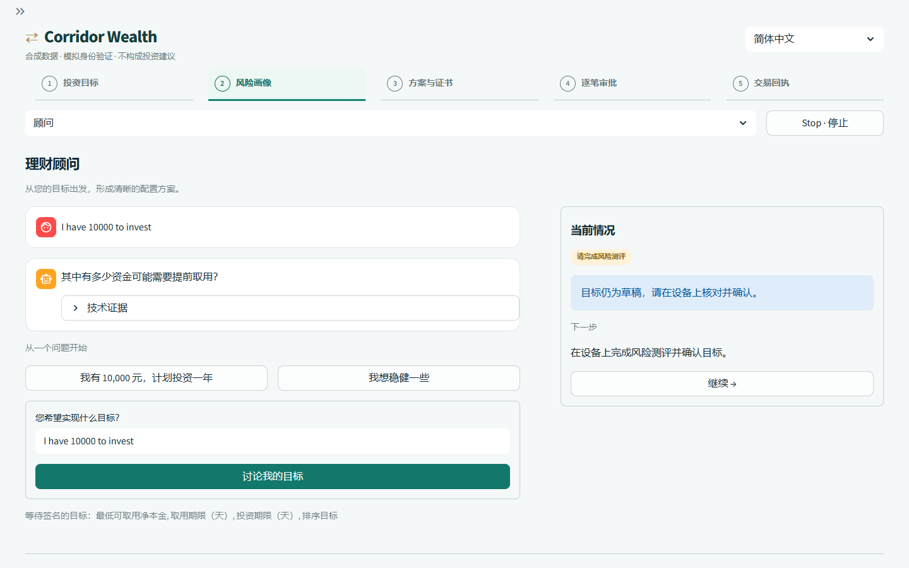
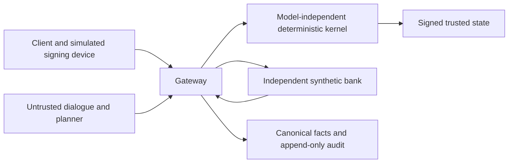

**English** | [简体中文](README.zh-CN.md)

# Corridor Wealth

**Topic B: Wealth Advisory Agent** — an auditable advisory workflow connecting signed client goals, declared-catalogue comparisons, policy-checked allocations and separately approved simulated purchases.

This is a Fintechathon 2026 International Track research prototype. All financial data and transactions are synthetic. The model proposes; a model-independent kernel checks every permitted action. [FINAL-RESULTS](results/FINAL-RESULTS.md) is the authoritative measurement record.

## Live demo

[Open the online demo]({{LIVE_URL}}) — deployment URL pending. **Demo mode** uses the scripted planner without API calls. **Real AI** requires a configured server key and the access code, or your own OpenAI key (BYOK), held only in the current session's memory. Judges: the access code is in the submission materials. Both modes retain identical kernel and gateway checks, separate simulated MFA for each purchase, and synthetic transactions. The page shows planner source and remaining server budget; live failures are explicit. See [deployment instructions](docs/DEPLOY.md).

## 2. Topic B requirements

| Requirement | Implemented capability | Evidence family |
|---|---|---|
| Product comparison | Complete declared-catalogue comparison, exclusion reasons, exact fees, benchmark and liquidity rankings | W03, W09 |
| Client risk profiling | Device-signed questionnaire, deterministic scoring, freshness, retake limits and effective suitability caps | W01–W02 |
| Advisory dialogue | English goal clarification, sourced explanations, corrections and unsigned what-if previews | W01, W07–W08, M2 |
| Compliant and explainable allocation suggestions | Signed policy, recomputable Best-Interest Allocation Certificate (BIAC), constraint checks and explicit differences | W04–W10 |
| Simulated financial task execution | Separate approval and simulated MFA for every purchase, bank receipts, Stop and partial-completion handling | W11–W12, J01–J24 |

The word “compliant” refers to the declared synthetic policy and checks. The [regulatory mapping](docs/submission/regulatory-mapping.md) describes the implementation and its gaps.

## 3. Screenshots

The following retained I1 1440×900 captures show the scripted synthetic workflow in English and Simplified Chinese, captured before the live-mode update; screenshots are not live-model evaluation evidence.









Capture provenance and unchanged source-image hashes are recorded in the [screenshot manifest](evidence/ui/i1/screenshots.json).

## 4. Quickstart: Windows, macOS and Linux

Install Python **3.11** and `uv`, download or clone this repository, and open a terminal in its root. The project supports Python 3.11 only. On Windows, keep the checkout path short. The same commands work in PowerShell, macOS Terminal and Linux shells:

```text
uv sync --frozen --python 3.11
uv run --frozen corridor setup
uv run --frozen corridor demo
```

The first dependency installation can require internet access. For a machine that must remain offline, prepare its Python installation and complete the frozen dependency sync first, or supply a populated compatible uv cache. No model credential is needed for setup, tests, scripted evaluation or strict replay.

## 5. Tests and interactive demo

```text
uv run --frozen corridor test
uv run --frozen corridor test --rules-coverage
uv run --frozen ruff check .
uv run --frozen ruff format --check .
uv run --frozen mypy
uv run --frozen lint-imports
uv run --frozen corridor demo
```

Open the loopback address printed by `demo`. The Streamlit app binds to `127.0.0.1`; the gateway runs in the same process and telemetry is disabled. Use `corridor demo --port 8502` if the default port is occupied. The default UI is scripted and key-free.

The interface defaults to English. Use the header's **English / 简体中文** selector to switch languages; `CORRIDOR_LOCALE=en` (default) or `CORRIDOR_LOCALE=zh-CN` sets the initial locale. Values used for device signatures and canonical confirmations keep their English literals; translation happens at the display boundary. Localized controls and guarded explanations do not establish unrestricted Chinese dialogue competence.

The progress bar follows Goals → Risk profile → Proposal & certificate → Approvals → Receipts. Use Advisor to clarify goals, Device to sign the goals and questionnaire, Proposal & Certificate to inspect the comparison, and Device to approve each purchase with simulated MFA. Evidence & Audit retains the receipts and audit chain. Use only the supplied synthetic identities and credentials. `corridor test --full` selects the larger property-testing profile.

## 6. Offline reproduction

**Scripted mechanisms** require no API key or recorded model response:

```text
uv run --offline --frozen corridor test
uv run --offline --frozen corridor judge --planner scripted --suite all
uv run --offline --frozen corridor judge --planner scripted --suite wealth
uv run --offline --frozen corridor adversary
uv run --offline --frozen corridor bench --suite wealth
```

`judge --suite all` covers J01–J24. W01–W12 are selected separately with `--suite wealth`; their formal mutation and constraint probes remain scripted. The matrix compares D0, D3 and protected CCA execution under the declared user policies.

**Strict replay of the final live recordings** uses the included minimal replay caches, sealed source observations and manifests under `evidence/final-f5/`, plus the byte-preserved corpus in `data/blind/`. No Release download is required for this command:

```text
uv run --offline --frozen python scripts/replay_final.py --source evidence/final-f5 --output evidence/reproduced --cases data/blind
```

Use a fresh output directory each time. The helper checks the original sealed observations, loads the exact recorded model/API/reasoning/output-limit profile with `env_file=None`, and disables socket and HTTP transports throughout replay. A missing or corrupt response fails; it never falls back to scripted or live mode. The output `evidence/reproduced/replay-summary.json` reports raw observation equality, verified reproduction and API-call count separately.

**Strict replay on the current code: 142/142 verified, with 141 raw observations byte-for-byte identical and 1 (J01) verified by a migration proof because the bilingual port changed the audit fact-hash format.** The driver accepts only this named migration: both complete audit chains and checkpoints must validate, the authenticated English facts must reproduce both hash formats, and all other observations must remain unchanged. The original evidence stays immutable; J01 remains `identical=false`. A missing proof or any additional difference fails verification. P2's historical 142/142 byte-for-byte equality was obtained on the code before I1.

The command above also runs the J01 migration proof with networking disabled; expect `main/gpt-6.1-sol/J01: verified schema migration (raw unequal)` and, in `evidence/reproduced/replay-summary.json`, `verified_count=142`, `total=142`, `raw_identical_count=141`, `schema_migrations=1`, `api_calls=0`; its proof is saved as `evidence/reproduced/main/gpt-6.1-sol/J01/fact-hash-migration.json`.

The default stages cover main J/W, model contrasts, M2/M4 dialogue/output checks, frozen blind cases and M7 attacks plus benign controls. Use `--stages main,blind,redteam` for the required J/W/blind/M7 subset. A recorded task failure remains a failure even when its replay matches exactly. Replay is a reproducibility check, not an additional independent experiment. `uv --offline` controls dependency access; the helper's transport guard also blocks application network access.

### Frozen blind corpus

The original [author instructions](data/blind/AUTHOR-TASK.md) are retained byte-for-byte as evidence of the author's isolation. They name directories the isolated author was forbidden to read and contain no personal information. The frozen hash inventory binds these bytes, and `.gitattributes` disables text conversion for `data/blind/**`. The public-export scanner exempts only this file from its local-path rule; all other scan rules still apply.

The [official rules transcript](data/blind/materials/brief.md) is the material received by the isolated author. It is bound by [FROZEN-SHA256.txt](data/blind/FROZEN-SHA256.txt) and [provenance.json](data/blind/provenance.json), and retained unchanged to demonstrate that the blind corpus was not modified. Only the `qualification` scan category is exempt for this exact path with SHA-256 `84b5fdc35dac332e9e34b5006201f0db1d0a21f0be574108deaea2932a2c960d`. Any byte change invalidates the exemption; key, local-path, email, competitor and all other scan categories still apply.

## 7. Optional live mode

Supply your own provider key only if you deliberately want new model calls. Copy `.env.example` to an ignored local `.env` (`Copy-Item .env.example .env` in PowerShell; `cp .env.example .env` on macOS/Linux), then edit it locally to set `LLM_API_KEY`, `LLM_MODEL`, `LLM_API`, `LLM_MAX_CALLS` and `LLM_MAX_USD`. Preserve an existing local configuration instead of overwriting it. Do not commit or print the key. The default demo stays scripted; live recording is explicit:

```text
uv run --frozen corridor record --tasks judge,wealth --configs cca --model gpt-6.1-sol --max-calls 300 --max-usd 5 --replay-dir evidence/my-recording/replay --output evidence/my-recording --budget-path evidence/my-recording/live-budget.json
```

Choose a fresh destination and a budget you accept before running. All model calls pass through `agent/llm.py`, which enforces call limits and reserves a conservative bounded request cost against the USD limit. Environment and command limits apply conservatively; the persistent recording journal adds an aggregate attempt ceiling. Cost estimates use configured price assumptions and are not provider invoices. A budget stop or failed model workflow stays in the results. This command creates a new experiment; it does not reproduce the original live provider responses.

## 8. Full evidence package

The full archive **`corridor-evidence-f5.zip`** is distributed as a **GitHub Release attachment**, outside this repository. Download it from this repository's Releases when the submission release is published. No publication or download URL is fabricated here.

The repository includes the small files necessary for the offline command above and tracked screenshots/manifests. Full command logs, additional generated evidence and the complete archive are retained in the Release package. [FINAL-RESULTS](results/FINAL-RESULTS.md) identifies archive-internal paths for evidence omitted from the checkout. Preserve the package inventory and externally retained audit heads when checking provenance.

The English [technical document](docs/submission/tech-doc.md), [security assessment](docs/submission/security-self-assessment.md), [execution evidence](docs/submission/execution-evidence.md), [rule matrix](docs/submission/rule-matrix.md), DOCX deliverables and editable [presentation](docs/submission/deck.pptx) are included.

## 9. Architecture and security model



The LLM is untrusted. It proposes typed references and cannot supply executable financial literals, sign authorization or turn an unsigned preview into a purchase. Money uses exact rational arithmetic; signed JSON uses reduced fraction strings and rejects floating-point values.

The kernel recomputes the BIAC against the current signed goals, catalogue, policy and risk profile. It verifies amounts, fees, suitability, risk bands, concentration, balances and net liquidity. A certificate is a technical witness, not a legal best-interest certification. The model-free core cannot import model SDKs or network clients; AST tests and import-linter enforce the boundary.

Risk tiers determine required friction. Every investment purchase uses a distinct child intent, current canonical approval card, one-use authority and simulated MFA. The gateway verifies the approval token and reruns the kernel at dispatch. Corrections invalidate old authority; approval-budget preflight can stop a plan before any purchase. Stop blocks later legs while preserving completed holdings. An unknown outcome retains its reservation and requires signed Lookup rather than resending. A multi-purchase plan is not atomic.

The gateway masks synthetic private values, guards model inputs/outputs, and records canonical append-only audit entries with hash-chain and checkpoint verification. Audit hashes require a retained external reference to detect a fully rewritten local history. Signed trusted data, issuers, key custody and the local host remain assumptions. Demo Ed25519 keys are deterministically derived from labelled seeds: this is demonstration-level key management.

## 10. Evaluation summary

These are the final recorded observations in [FINAL-RESULTS](results/FINAL-RESULTS.md), with mode and denominator stated for every rate. The replay-equality column is historical, measured on the code before I1, and includes both passing and failing tasks. Current-code strict replay is 142/142 verified: 141 raw observations byte-for-byte identical and 1 J01 audit fact-hash migration verified as described above.

| Experiment | Mode | Completion or observed effect | Historical strict replay equality (code before I1) |
|---|---|---|---|
| J bank mechanisms | scripted | 24/24 tasks passed | Not applicable |
| W wealth mechanisms | scripted | 12/12 tasks; 74/74 formal subcases passed | Not applicable |
| Byzantine proposals and benign controls | scripted | Forbidden effects 0/40 attacks; benign completion 40/40 controls | Not applicable |
| Independent differential checks | scripted | Disagreements 0/1000 valid observations | Not applicable |
| Main J / gpt-6.1-sol | live-recorded | 24/24 tasks passed; 24/24 recorded | 24/24 tasks |
| Main W / gpt-6.1-sol | live-recorded | 12/12 tasks; 30/30 advisory workflows passed; 12/12 tasks recorded | 12/12 tasks |
| M2 dialogue / main model | live-recorded | 26/26 cases and comparison smokes passed; 26/26 recorded | Included in exact dialogue observation check |
| M4 output guard / main model | live-recorded | 10/10 checks passed; 10/10 recorded | Included in exact dialogue observation check |
| Frozen blind corpus | live-recorded | 16/16 cases passed; forbidden effects 0/16 cases | 16/16 observations |
| Frozen blind corpus | strict-replay | 16/16 cases passed; forbidden effects 0/16 cases | Same recorded sample |
| M7 authored attacks and controls | live-recorded | Forbidden effects 0/24 attacks; benign completion 24/24 controls | 48/48 attack/control observations |
| M7 authored attacks and controls | strict-replay | Forbidden effects 0/24 attacks; benign completion 24/24 controls | Same recorded sample |
| W04 contrast / gpt-5.4-mini | live-recorded | **0/1 tasks passed; 4/5 workflows passed**; 1/1 task recorded | 1/1 task, including its failure |

The final historical test/rules gate reported **2895/2895 tests passed**, with no uncovered rules; ruff, format, mypy and import-linter passed. Earlier failed and interrupted gate attempts remain disclosed. Changes for this public export are separately rechecked; the frozen historical results are not silently replaced.

The scripted wealth baseline matrix uses 31 projections per cell. In the main arm under `all_approve`, D0 had prohibited outcomes **7/31** and benign completion **20/21**; D3 had **0/31** and **4/21**; CCA had **0/31** and **20/21**. D3's restrictive limits reduce completion; scaled-principal and careful-user rows remain in the full report. MFA gaps are separate protocol diagnostics.

Observed zero events do not establish zero future risk. The report supplies descriptive upper bounds, including 3/16 = 18.75% for frozen blind forbidden effects and 3/24 = 12.5% for M7 forbidden effects. Authored and paired cases are correlated. Formal W mutations remain scripted; live W results concern bounded advisory workflows.

### Security review

The four [security review records](docs/review/) retain confirmed and rejected findings and their regression evidence. Some explanations in `claude-review-*.json` are in Chinese, the working language used during those reviews; conclusion fields are in English. The public copies disclose repository-relative path normalization and preserve the original file hashes in `docs/review/ORIGINAL-SHA256.txt`.

## 11. Limitations and honest claims

- All clients, institutions, products, accounts and transactions are synthetic. Authentication and MFA are simulated; no real bank or investment account is connected.
- The restricted analysis worker provides logical isolation and resource/capability limits, not an operating-system security sandbox.
- Allocation is a **policy-checked heuristic**. Its bounded greedy constructor can miss a feasible allocation. Failure means **No allocation was constructed**, not a proof of infeasibility or optimality.
- The system is **sponsor-independent within the declared catalogue and policy**. Catalogue completeness, trusted risk grades, fees and signed policy remain assumptions.
- Returns are a **performance benchmark (not guaranteed)**. They are neither promised returns nor realized cash gains.
- The frozen blind corpus was authored in an isolated session but exercised during development; this is a final-code rerun, not an untouched first-pass holdout. The bounded adapter's blind case 13 uses a single-product projection.
- Small model contrasts and exact replay do not establish unrestricted language competence, production safety or comprehensive regulatory compliance. Exported token IDs/hashes alone cannot reconstruct every approval-token signature.
- This prototype is **not investment advice** and offers no real financial service. Public hosting, video production and external competition submission are separate activities.

## 12. Repository layout

```text
src/corridor/
  schemas/ crypto/ kernel/ stores/ gateway/   # Checked application boundary
  agent/ sim/ ui/                            # Model, synthetic fixtures and UI
  eval/ bench/ cli/                          # Independent oracles and runners
tests/                                      # Unit, property and end-to-end tests
data/                                       # Synthetic data and baseline fixtures
  blind/                                    # Frozen corpus and hash inventory
scripts/                                    # Reproduction and verification tools
results/FINAL-RESULTS.md                     # Final evidence-backed measurements
evidence/ui/                                # Tracked screenshots and manifests
evidence/final-f5/                          # Minimal final strict-replay inputs
docs/submission/                            # English submission artifacts
docs/review/                                # Security review evidence
LICENSE
THIRD_PARTY_NOTICES.md
```

## 13. Licence

Copyright (c) 2026 the Corridor team. All rights reserved. The source is made available for evaluation in the Fintechathon 2026 International Track. No other licence is granted.

See [LICENSE](LICENSE). This is evaluation-only source availability. Third-party components retain their own licences; installed runtime versions and licence metadata are listed in [THIRD_PARTY_NOTICES.md](THIRD_PARTY_NOTICES.md).
