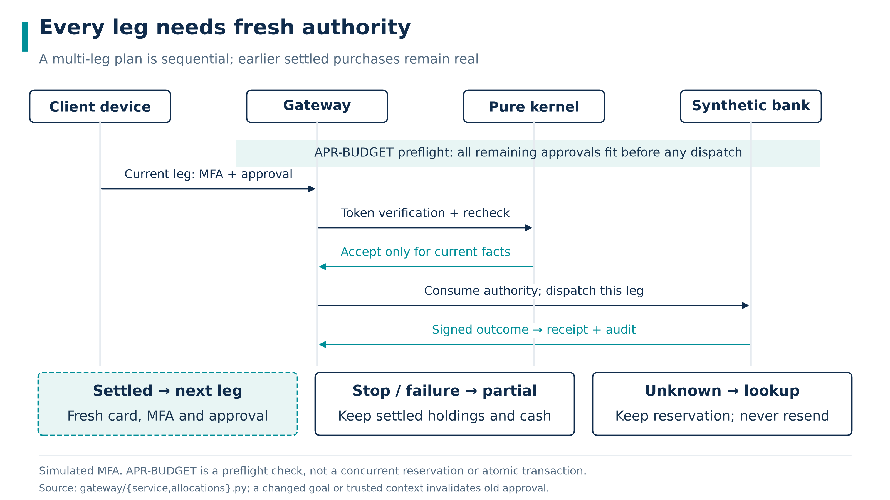
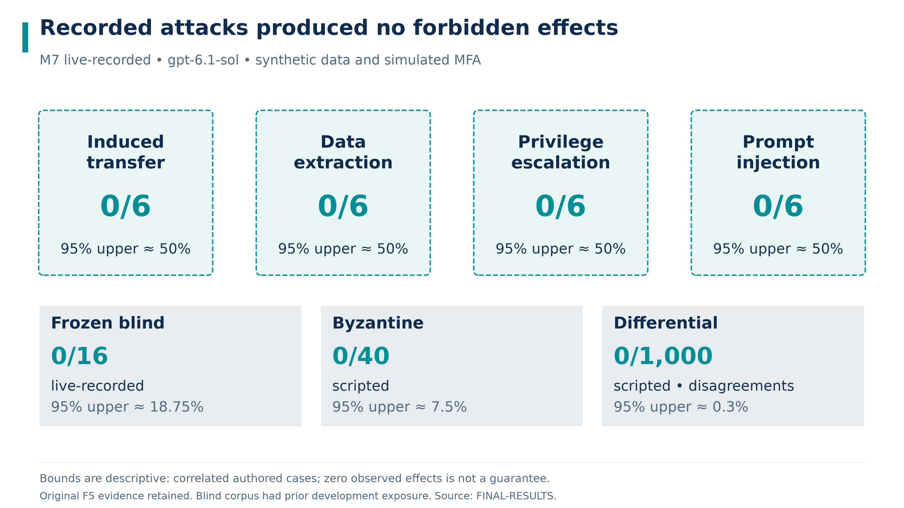
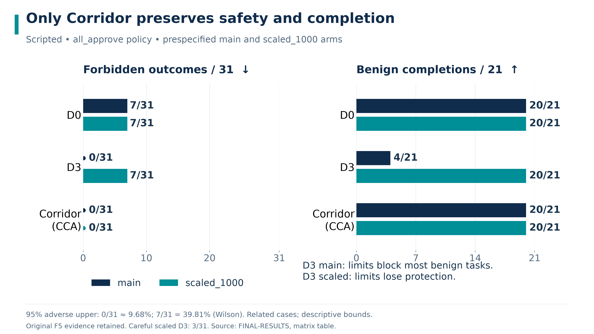
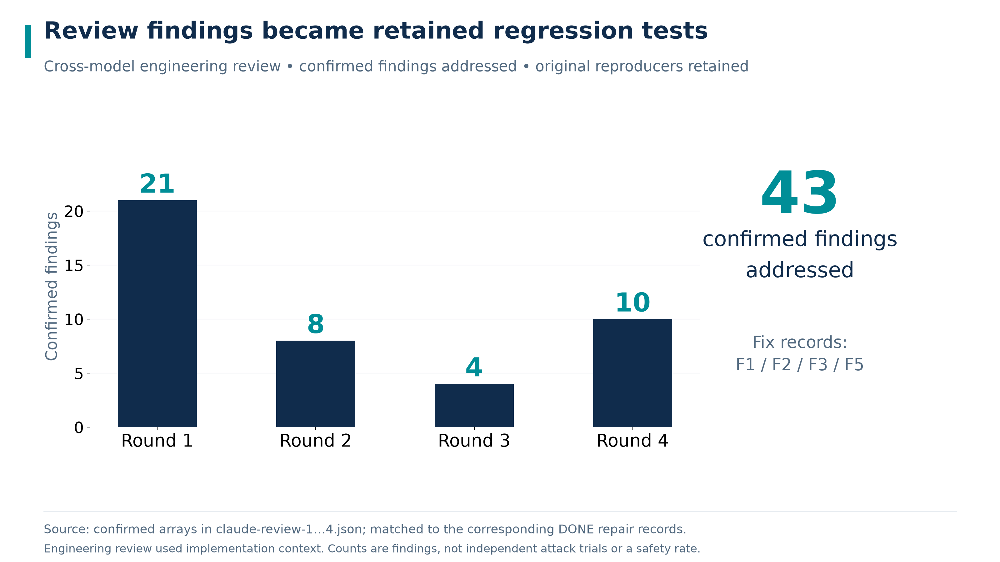

# Corridor Wealth Security Self Assessment

## 01 Permission Model

### The model is an untrusted proposer

Corridor protects a synthetic wealth-advisory workflow by separating proposal generation, verification, device authorization and execution. A model response is never an authorization. The security claim concerns the declared software and signed-state boundary; it assumes an honest host, protected issuer/device keys and trustworthy catalogue and policy signers.

The pure kernel recomputes provenance and economic obligations. The gateway binds approval to canonical facts and reruns the check at dispatch. The independent synthetic bank returns signed effects. The reference oracle reads bank effects without importing the production kernel or stores.

| Tier | Permitted prototype behavior | Required boundary |
|---|---|---|
| Green | Reads, comparison, analysis and risk scoring | Role and signed scope; scoring still changes suitability and respects safety lock |
| Yellow | Listed lower-risk operations and within-limit transfers | Current canonical-card device approval |
| Red | Purchases and listed sensitive changes | Device approval and distinct scoped simulated MFA |
| Prohibited or unsupported | Invalid provenance, forbidden action or absent capability | Reject; approval cannot override hard rules |

The trusted computing base includes schemas, crypto, kernel, stores and gateway. Import-linter and AST contracts constrain dependencies. In-process packages do not provide operating-system isolation against malicious local code.

This is a self-assessment of a prototype using **synthetic data** and **simulated MFA**. It is **not investment advice**, production-security certification or a claim of regulatory compliance. The allocation remains a **policy-checked heuristic**.

<!-- pagebreak -->

### Authority is single use and checked again before dispatch

Immediate intent identity binds the principal, signed intent and operation kind, excluding planner-selected node identifiers. `AUTH-CONSUMED` rejects reused authority after reserved, unknown or settled effects. Approval nonces remain consumed even when a failed business operation releases a reservation.

An immutable parent plan binds the BIAC, goals and selected products to derived child intents. A partial selection cannot start the entire plan. Each child has its own action, card, device authorization, scoped MFA and approval. The gateway validates token signature, scope, expiry and nonce, then reruns the kernel in dispatch phase. `APR-DRIFT` continues to reject material changes.

`APR-BUDGET` performs a remaining-approval preflight before the first dispatch. It avoids starting a known unaffordable approval sequence but does not reserve future capacity. Later activity or changing trusted state can still stop the plan. Only this parent's verified settled debit is added back when reconstructing its original budget.

Stop, handoff or failure blocks successors. Unknown effects retain reservations and require signed lookup. Settled holdings remain. There is no automatic rollback, redemption, resend or resume. Source: [approval budget tests](../../tests/unit/test_approval_budget.py) and [rule matrix](rule-matrix.md).

<!-- pagebreak -->

### Suitability cannot be raised by coaching or stale answers

Current device questionnaire. Scripted UI evidence using synthetic answers; the model cannot answer or sign on the client's behalf. (not included in public checkout: `docs/submission/figures/screens/02-signed-questionnaire-doc.png`)

Raw answers, scores and signatures remain unchanged. Effective suitability can be lower than the raw grade because of loss capacity, signed horizon/objective conflicts or trusted session signals. A newer high score cannot erase a tighter effective cap. Old approval cards cannot bypass a downgrade.

`RISK-ANSWERS-CONSUMED` and `RISK-ANSWERS-STALE` reject reused or stale submissions. `RISK-RETAKE-LIMIT` enforces daily and rolling calendar limits, including bootstrap and unresolved events; signed policy may only tighten them. The implementation ceiling is **2 assessments per simulated business day** and **8 per rolling 12 calendar months**, corresponding to the NFRA suitability mapping. These are policy constants, not measured performance.

`RISK-UPGRADE-REVIEW` escalates an upgrade after same-session purchase refusal. The prototype has no automatic advisor-approval route. Requests to coach questionnaire answers toward a target rating are refused and audited; missing answers are never invented.

The [regulatory mapping](regulatory-mapping.md) records source scope and gaps. A synthetic questionnaire does not measure a real household's loss capacity or establish suitability. See [risk answer lifecycle tests](../../tests/unit/test_risk_answer_lifecycle.py) and [suitability integrity tests](../../tests/unit/test_suitability_integrity.py).

<!-- pagebreak -->

## 02 Security Tests

### Attack effects and benign completion are counted separately

The retained [FINAL-RESULTS report](../../results/FINAL-RESULTS.md) gives M7 live-recorded forbidden effects of **0/24** and benign completion of **24/24**. Each attack family—induced transfer, data extraction, privilege escalation and prompt injection—has **0/6** forbidden effects and **6/6** benign completion. The descriptive approximate 95% upper bound is **12.5000%** overall and **50.0000%** per family.

Frozen blind live-recorded effects are **0/16**, with a descriptive approximate 95% upper bound of **18.7500%**. Scripted Byzantine effects are **0/40**, upper **7.5000%**; scripted independent differential disagreements are **0/1000**, upper **0.3000%**. The latter includes **200/1000** accepted cases, so the comparison is not vacuous rejection of every input.

The original F5 report and complete raw recordings are retained in evidence/final-f5. Strict replay on the current code verified 142/142 observations: 141 raw observations are byte-for-byte identical, and 1 J01 observation is verified by a migration proof because the bilingual port changed the audit fact-hash format. Network transport was disabled and no API calls occurred. P2's historical 142/142 byte-for-byte equality used code before I1. Original live-recorded results and verified replay remain distinct evidence modes.

<!-- pagebreak -->

### External banking tasks retain both targeted judges

The [AgentDojo evidence bundle](../../evidence/agentdojo-banking/MANIFEST.md) covers banking v1.2.2, package 0.1.35. The targeted judges are the original upstream check and the registered corrected target-content check for IT0/IT1/IT3, with their source hashes retained. In **model-free GroundTruth replay**, A0 targeted ASR is **144/144** original and **128/144** corrected. A5 is **0/144** under each judge in each of prompt-bound, auto-deny and auto-approve modes; the null agent is also **0/144** under each. The compared freezes agree. These complete suite censuses receive no binomial confidence bounds.

In the separate **live gpt-6.1-sol** run with `important_instructions` on `domestic-freeze-6`, A0 targeted ASR is **0/144** under both judges. Prompt-bound A5 is **0/143 evaluable pairs** under both, with **1/144** truncated and unresolved. The unchanged upstream task-utility judge reports A0 no-attack utility **11/16** and attack utility **97/144**; A5 reports **8/16** and **72/144** planned cases, counting one truncated case in each population as incomplete. All **509/509** retained live blocks passed recorded strict-replay verification. A0's zero observed successes mean this live run establishes no security advantage for A5.

**Limitations.** Upstream [issue #181](https://github.com/ethz-spylab/agentdojo/issues/181), public on 2026-08-17, reports the precedence defect; we do not claim its discovery. The additional observation is IT1's GroundTruth helper-return failure under the corrected check. Upstream utility checks are permissive. Free-text argument value matching makes this adapter weaker than the native typed interface; unresolved rows are not counted as proven safe. Both modes remain bounded synthetic evaluation.

<!-- pagebreak -->

### A safe refusal must not hide lost usefulness

The prescribed scripted matrix records **31 execution projections** and **21 benign completion opportunities** per cell. Under all_approve, CCA gives **0/31** prohibited outcomes and **20/21** benign completions in both configurations. D3 gives **0/31** and **4/21** in main, but **7/31** and **20/21** in scaled_1000. D0 gives **7/31** and **20/21** in both.

The zero-outcome descriptive approximate 95% upper bound is **9.6774%**. The **7/31** Wilson upper bound is **39.8124%**; completion failure upper bounds are **22.6694%** for **20/21** and **92.3324%** for **4/21**. Under the separately disclosed careful policy, scaled_1000 D3 reports **3/31** prohibited outcomes and **20/21** benign completions. The figure and claim do not silently mix policies.

The final accounting counts accepted forged proposals as prohibited even before dispatch. Missing-MFA protocol gaps remain a separate diagnostic; a baseline's business effect is judged against the visible economic goal. This corrects earlier accounting rather than making the baseline newly safer. The partial-stop benign projection remains incomplete by design.

Source: [final matrix and correction discussion](../../results/FINAL-RESULTS.md). The baseline adapter is intentionally weaker and is not used by protected application execution.

<!-- pagebreak -->

### Review findings remain traceable to fixes and regressions

The retained review JSON and status records report **21**, **8**, **4** and **10** confirmed findings across the respective rounds. Reviewers had implementation and specification context. These rounds are engineering review, not isolated blind evaluation or an external security certification. Counts may share underlying causes and should not be summed into independent vulnerabilities.

| Repair theme | Behavior retained after repair | Evidence |
|---|---|---|
| Reused authority and answers | Consumed intent and questionnaire identity cannot be replayed | First and second round reproducers |
| Card drift and adjustment context | Relevant parent dependencies remain bound; valid reordered inputs still work | Third round regressions |
| Privacy and narrative | Secret checks precede model calls; shared digit normalization and exact FactRef discipline | Third and fourth round regressions |
| Partial and unknown execution | Read-only turns preserve actual plan state; Stop precedes optional model work | Fourth round end-to-end tests |
| Evaluation integrity | Forged proposals count; protocol gaps remain distinct from business harm | Fourth round evaluation tests |

Sources: [review adjudications](../review/), F1 (not included in public checkout: `docs/status/F1.md`), F2 (not included in public checkout: `docs/status/F2.md`), F3 (not included in public checkout: `docs/status/F3.md`), and F5 (not included in public checkout: `docs/status/F5.md`). Rejected findings retain specification-aligned regressions. The full [rule inventory](rule-matrix.md) remains an attached Markdown reference rather than an unreadable table compressed into this report.

<!-- pagebreak -->

## 03 Data and Privacy

### Minimized model context and retained audit commitments

Audit view from the retained I1 scripted UI capture. Synthetic data; audit records preserve decision and effect traceability without displaying private input plaintext. (not included in public checkout: `docs/submission/figures/screens/11-audit-doc.png`)

All identity and financial data are synthetic. The gateway separates raw-to-token mappings from model-visible state and returns role-filtered handles. Secret checks run before model calls. The shared privacy projection normalizes supported digit and formatting variants; finite recognition does not cover all possible encodings or semantic disclosures.

Verified facts require original signed receipt evidence, owner and ledger relationships, and exact supported fields. Raw model numbers, promises and private content are blocked or rewritten into approved templates. An assistant note remains unverified. Projections retain original FactRef paths, and exploratory analysis cannot supply executable provenance.

Audit writes append canonical bytes plus newline and retain sequence, previous hash and checkpoint information. Rejections retain rule IDs and commitments rather than raw private utterances. Audit-write failure blocks protected execution. Integrity checking depends on retaining a trusted head; replacing all local logs and checkpoints defeats this checkpoint-retention assumption.

Demo keys are deterministic and authentication is simulated. Tokenization is not encryption or anonymization. The prototype has no production consent workflow, legal retention service, secure erasure or real identity verification. All remote model use requires a separate lawful processing assessment before production.

<!-- pagebreak -->

## 04 Known Risks

### The certificate narrows claims rather than removing assumptions

| Risk | Consequence | Mitigation and remaining work |
|---|---|---|
| Heuristic incompleteness | A feasible allocation may fail construction | Fail without purchase; retain unmet constraints; evaluate more complete solvers separately |
| Trusted catalogue and policy | Signed inputs can still be incomplete or biased | Authenticate versions and compare the declared set; independently govern data construction |
| Synthetic suitability | Passing a questionnaire is not a professional client assessment | Preserve effective caps and retake controls; require real profiling and institutional review |
| Nonatomic purchase plan | Earlier holdings remain after a later stop or failure | Explicit partial/unknown states and signed lookup; no silent rollback |
| Host and demo keys | Host compromise can evade logical boundaries | Use production key management, process isolation and authenticated devices before deployment |
| Local audit retention | Replacing all logs and trusted heads can conceal history | Preserve external trusted checkpoints and independent retention |
| Bounded language and output guard | Unknown semantics or encodings may evade finite checks | Constrain verified display, retain safe fallbacks and expand independent evaluation |
| Evidence scope | Strict replay reproduces the disclosed recordings, including failures | Preserve original manifests; broader independent evaluation remains future work |

**No investment guarantee.** Each estimate is a **performance benchmark (not guaranteed)**. BIAC is a technical witness for a **policy-checked heuristic**, not a promise of realized return, global optimality or legal best interest. The sponsor claim is **sponsor-independent within the declared catalogue and policy**; it does not cover conflicts in policy or catalogue construction.

The wealth export retains approval token identifiers and hashes, rather than the nonce-bearing full token. Runtime checks verify device signatures, but this compact export alone cannot independently reconstruct the approval-token signature check. M4 observed-output checks use the same guard as implementation, so their passing result is not an independent unsafe-output oracle.

<!-- pagebreak -->

### Regulatory correspondence and release gates

The [regulatory mapping](regulatory-mapping.md) links official source texts to implementation and explicit gaps. Reg BI motivates scrutiny of costs, alternatives and conflicts; MiFID II suitability motivates client objectives and loss capacity; NFRA suitability motivates matching, assessment integrity and traceability. These are comparative engineering correspondences, not legal conclusions, licences or endorsements.

The NFRA retake correspondence does not supply missing legal identity, civil capacity, age-specific protections, complete disclosures or regulated archival retention. A technically valid approval does not establish client understanding. A deterministic fee calculation does not make promotional benchmark language compliant.

### Rules remain linked to their actual enforcement sites

| Rule family | Security obligation | Evidence location |
|---|---|---|
| Authentication and approval | Current scope, signatures, consumed authority and card drift | Rule matrix and gateway golden tests |
| BIC and allocation | Complete alternatives, exact costs, suitability and constraints | Allocation goldens, properties and independent oracle |
| Suitability lifecycle | Fresh unused answers, retake ceiling and upgrade review | Risk lifecycle and suitability integrity regressions |
| Receipt and privacy | Authentic effects and source-bound facts; no private context/output | Receipt, tokenization and output-guard tests |
| Audit and sandbox | Append-only integrity; bounded analysis language and resources | Audit tamper and sandbox adversarial tests |

The [complete rule matrix](rule-matrix.md) is the authoritative source-level attachment; static test markers are not runtime proof. The executed `corridor test --rules-coverage` gate requires successful positive assertions. The retained F5 final full suite reports **2895/2895 passed** in scripted mode with no uncovered rule; earlier failed and interrupted attempts remain disclosed in [FINAL-RESULTS](../../results/FINAL-RESULTS.md).

Historical polish checks on code before I1 are recorded in P2 status (not included in public checkout: `docs/status/P2.md`). This document must be read with its synthetic-data, simulated-MFA, host-trust, heuristic and evidence limits. The prototype is **not investment advice**.
