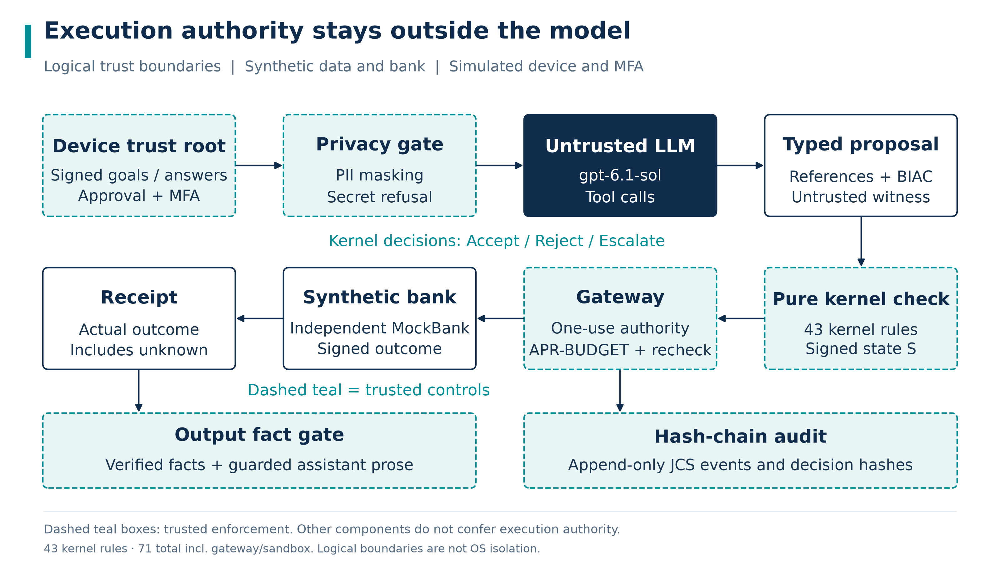
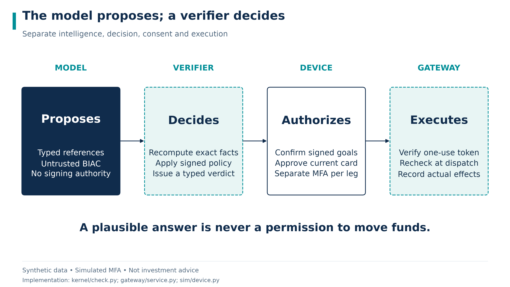
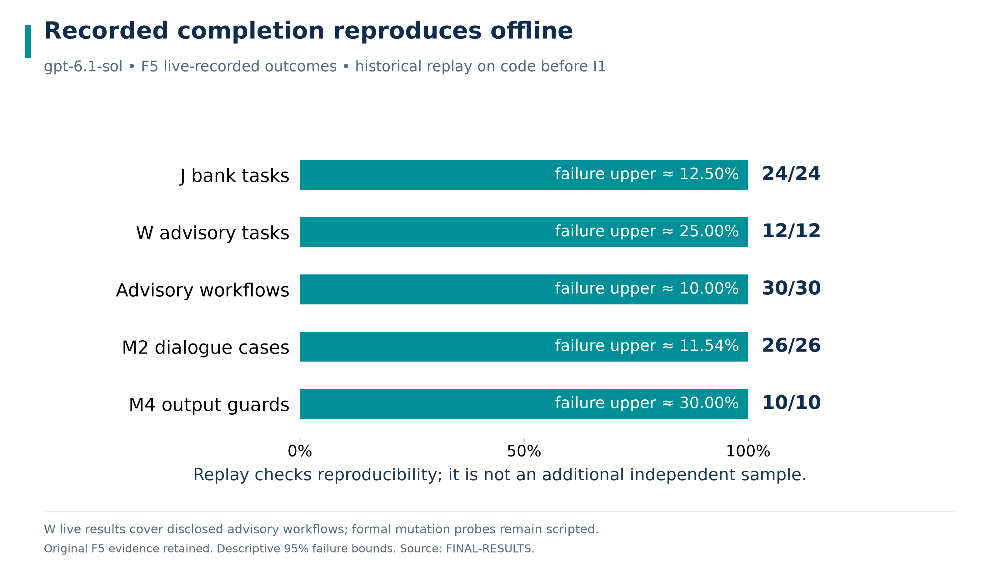

# Corridor Wealth Technical Document

## 01 Project Overview

### Wealth advice that remains inspectable at execution

Corridor Wealth is a synthetic advisory and purchase workflow for International AI Track Topic B. A client clarifies goals, reviews a complete declared product comparison, receives a policy-checked allocation and separately approves each purchase. The model proposes; an independent checking path decides whether the proposal may execute.

The motivating failure is a persuasive recommendation that cannot justify its numbers, suitability or authority. A model may omit a cheaper eligible product, repeat an issuer's promotional claim, or treat a malicious document as an instruction to buy. Corridor requires financial facts and permissions to survive deterministic checks even when model output is hostile.

The Best-Interest Allocation Certificate, or BIAC, carries the signed context, eligible alternatives, selected amounts, costs and constraints needed to recompute a proposal. The client can inspect what was excluded and why. The gateway then binds approval to the current canonical facts and checks again before execution.

**Claim boundary.** The allocation is a **policy-checked heuristic**, and is **sponsor-independent within the declared catalogue and policy**. These are technical properties of a bounded synthetic workflow, not a legal best-interest certification. All institutions, products, accounts and people use **synthetic data**. Authentication uses **simulated MFA**. This prototype is **not investment advice**.

### What the judge can inspect

The following pages connect the client workflow to its trust boundary, certificate computation, approval lifecycle and reported evaluation. The companion security assessment states threat assumptions and residual risks. The execution evidence document distinguishes retained F5 measurements from retained I1 scripted UI evidence captured before W1 and records current offline replay verification.

<!-- pagebreak -->

### Topic B is an end to end client workflow

Current Advisor clarification screen. Scripted UI evidence using synthetic inputs; no live-model result is implied. (not included in public checkout: `docs/submission/figures/screens/01-clarification-doc.png`)

| Required capability | Client experience | Inspectable mechanism |
|---|---|---|
| Product comparison | Review eligible and excluded products, fees and liquidity | Complete declared catalogue with deterministic rankings |
| Client risk profiling | Review and sign questionnaire answers on the device | Freshness, consumption, scoring and effective suitability checks |
| Advisory dialogue | Clarify missing goals; ask why; correct or stop | Unsigned draft slots, sourced facts and explicit state transitions |
| Explainable allocation | Review weights, costs and differences before selection | Signed policy and recomputable BIAC |

The prototype allocates new money from a CNY funding account for a single synthetic client. Existing holdings do not enter the allocation-weight denominator. Historical holdings still remain visible after a partial purchase. There is no automatic rebalancing, real financial account connection or market forecast.

The official Topic B wording asks for a professional-style workflow. Corridor implements the interaction and evidence chain within a synthetic domain; it does not equate a short questionnaire or a certificate name with professional suitability.

Source: official topic requirements (not included in public checkout: `docs/submission/templates/international-topics-rules-en.docx`), accepted wealth design decisions (not included in public checkout: `docs/DECISIONS.md`), and [current workflow source](../../src/corridor/agent/wealth_dialogue.py).

<!-- pagebreak -->

## 02 System Architecture

### The trust boundary separates proposals from authority

**model proposes · kernel decides · device authorises · gateway executes**



The application trusted computing base comprises schemas, crypto, kernel, stores and gateway. The pure kernel reads trusted state and checks proposals without a model client or network dependency. The gateway resolves permitted references, renders the approval card, validates device evidence, serializes dispatch and writes the result.

The untrusted dialogue and planner may propose tool calls and typed references. The configured primary model is gpt-6.1-sol. Its role is to clarify intent and choose available operations; it cannot sign an input, issue an approval, fabricate a receipt or bypass the gateway. Input minimization precedes model calls. A fact gate and output guard constrain what the application presents as verified financial information.

The synthetic bank independently executes submitted operations and signs its receipts. The reference oracle does not import the production kernel or stores. This independence helps reveal shared-code errors, but a mistaken shared specification remains possible. The in-process Python boundary is logical isolation; it does not protect against hostile code with host memory or signing-key access.

Source: [rule and dependency inventory](rule-matrix.md), [import contracts](../../pyproject.toml), and [AST boundary tests](../../tests/unit/test_import_boundaries.py).

<!-- pagebreak -->

### Authority has distinct owners



| Component | Responsibility | It does not establish |
|---|---|---|
| Device and signed state | Explicit goals, answers, policy and operation scope | Real identity, civil capacity or production key management |
| Planner and prover | Typed proposal and candidate certificate | Correct arithmetic, client consent or execution permission |
| Pure kernel | Recompute provenance, costs, suitability and constraints | Truth of a signed catalogue or global allocation optimality |
| Gateway and bank | Current-card approval, dispatch checks and signed effects | Atomic completion of an entire allocation |

Money remains exact as rational values in memory and reduced rational strings on the wire. Executable amounts require whole cents. JSON floating-point values are rejected; display rounding does not alter signed values. Business time comes from the simulated clock, while deterministic identities keep repeated requests reproducible.

Device inputs, policies, catalogues, approvals and receipts use distinct signing contexts. Demonstration keys derive from a deterministic labelled seed. They are suitable for repeatable synthetic tests and unsuitable for production key management. See [cryptography implementation](../../src/corridor/crypto/) and [demo key derivation](../../src/corridor/sim/keys.py).

<!-- pagebreak -->

## 03 Agent Design

### A conversation becomes authority only after device confirmation

Device-signed goals in the retained I1 UI capture. Scripted evidence; goals and questionnaire answers remain separate explicit client actions. (not included in public checkout: `docs/submission/figures/screens/03-signed-goals-doc.png`)

The dialogue accumulates explicitly sourced, unsigned slots for amount, horizon, liquidity need and objective. Missing or ambiguous values cause clarification. A phrase such as "something safe" cannot set a risk grade or become an executable purchase amount. The device reviews the completed goal sheet and signs the structured request.

Questionnaire answers remain outside model authority. Raw answers and scoring evidence are preserved; effective suitability can be tightened by signed goals and trusted session signals. A higher raw grade cannot erase a tighter effective cap. Requests to coach answers toward a target rating are refused and audited.

Read-only explanation turns preserve an existing execution or reconciliation result. Stop withdraws authority before optional model work, so a model failure or strict-cache miss cannot prevent cancellation. Corrections supersede old inputs and terminate relevant pending plans; the new goal requires fresh device confirmation.

All model calls pass through the guarded LLM entry point. The API profile and bounded output settings are part of replay identity. A strict miss fails; it cannot silently substitute a scripted response into a live-model result.

<!-- pagebreak -->

### The BIAC exposes the complete declared comparison

Complete proposal and BIAC in the retained I1 UI capture. Scripted evidence using synthetic data and simulated authentication; factual fields and source links remain inspectable. (not included in public checkout: `docs/submission/figures/screens/04-proposal-biac-detail.png`)

The certificate exposes the selected products, risk bands, costs, constraints and source bindings together. Its checks are technical statements under the declared synthetic catalogue and policy, not a real-world suitability certification.

<!-- pagebreak -->

### Recomputing the certificate keeps its claims bounded

The kernel checks the current signed policy, catalogue and risk record before constructing the eligible set. Eligibility asks whether a product can accept an allowed candidate amount. This avoids excluding a useful partial holding merely because that product cannot accept the entire request principal. Every exclusion retains its applicable reasons.

Eligible products are ranked at a common reference amount and horizon. That ranking is explicitly comparison-only. Actual purchase amounts are priced separately, and fees are rounded upward per operation before aggregation. All displayed return estimates carry **performance benchmark (not guaranteed)**.

| BIAC makes recomputable | BIAC does not prove |
|---|---|
| Complete eligible set within the signed catalogue | Market-wide availability or an unbiased catalogue |
| Exact amounts, costs and net-liquidity checks | Future realized returns or liquidity under market stress |
| Signed risk bands, concentration and explicit deviations | Whole-household diversification or legal suitability |
| Binding from goals to the selected parent plan | Global optimality or atomic completion of every purchase |

Source: [allocation kernel](../../src/corridor/kernel/allocation.py) and accepted design decisions (not included in public checkout: `docs/DECISIONS.md`).

### The allocation algorithm fails conservatively

The selector is a bounded greedy construction. It allocates within signed risk-sleeve budgets, first addressing the net-liquidity requirement and then filling remaining capacity. It finally recomputes principal conservation, amount resolution, product limits, concentration, individual and group bands, fees, available funds and liquidity. The certificate cannot replace these recomputations with a claimed pass flag.

Accessible value is net principal after the synthetic contract's holding and redemption fees by the signed deadline. Projected return is excluded from this liquidity amount. Cash left outside the requested investment does not count toward the invested-principal requirement.

**Failure is not an infeasibility proof.** A feasible allocation can be missed by this heuristic. The correct outcome is "No allocation was constructed under this policy and these inputs." Construction failure remains a completion cost and does not authorize a weaker policy or an unverified alternative.

<!-- pagebreak -->

### Client corrections remain explicit and visible

Goal correction and comparison differences in the retained I1 UI capture. Scripted evidence; revised goals require fresh device confirmation and invalidate earlier approval. (not included in public checkout: `docs/submission/figures/screens/06-correction-doc.png`)

Explicit weights or selected products bind to a reconstructible default in the same economic context. The card retains the deviation and exact changes in amount, weight, fees, benchmark and liquidity. An unsigned what-if preview grants no authority. Selecting a preview must pass ordinary device signing and kernel validation again.

The comparison view connects each displayed change to authenticated before-and-after facts. A lower principal changes product amounts and derived benchmarks, while the old proposal and its approvals are withdrawn. The client can review the effect before deciding whether to sign and approve the revised plan. Chat does not make that decision for them.

A changed goal cannot erase a settled purchase. If execution has started, the workflow preserves the actual parent result and its holdings. Stop blocks later legs before optional model work. A new request requires a new device-confirmed intent; it cannot reuse a terminal plan or its consumed authority. This keeps correction, cancellation and reconciliation distinct and visible.

<!-- pagebreak -->

## 04 Security Design

### Every purchase is checked at the moment it can move money


The device selects the complete intended positive allocation and derives BIAC-bound child intents and separate authorizations. Each purchase receives a current canonical card, its own scoped simulated MFA grant and device approval. The gateway verifies the approval token and reruns the pure check in dispatch phase under its lock.

`AUTH-CONSUMED` prevents reused authority after reserved, unknown or settled effects. Approval nonce consumption is separate from a business reservation. A failed attempt may release reserved funds without making the same approval reusable. Material card drift still rejects.

`APR-BUDGET` checks whether approval capacity covers the remaining plan before the first dispatch. An unchanged propose/MFA lifecycle shares its count; distinct or drifted requests still count. This is a preflight check, not a reservation of future capacity: concurrent activity can still stop a plan after an earlier leg succeeds.

Source: [approval budget regressions](../../tests/unit/test_approval_budget.py), [gateway orchestration](../../src/corridor/gateway/orchestration.py), and [rule inventory](rule-matrix.md).

<!-- pagebreak -->

### Truthful recovery preserves the effect that actually happened

Partial completion after Stop in the retained I1 UI capture. Scripted evidence; the settled holding remains visible while the later purchase is cancelled. (not included in public checkout: `docs/submission/figures/screens/13-partial-stop-doc.png`)

Purchases are not atomic as a group. Stop, failure or handoff blocks later legs while retaining settled holdings. An unknown result retains its reservation and requires a signed lookup; the system does not resend an order to manufacture certainty. A correction cannot erase an earlier effect or silently restart a terminated plan.

Later legs reconstruct the original budget using only this parent's verified settled debit. Unrelated spending, changed policy or catalogue, expired risk or superseded inputs can invalidate the remaining operation. Dependencies are scoped to the relevant principal and parent, preventing unrelated plans from invalidating a legitimate card.

Private or secret-bearing utterances are rejected before model calls. Model-visible state uses minimized role-filtered handles. Verified receipt references preserve their original source paths; raw model numbers and guarantees cannot become verified narration. Finite privacy and output guards remain bounded checks, not proof against all encodings or meanings.

Audit records append canonical bytes, retaining decisions, rule identifiers and commitments. A write failure blocks protected execution. Chain verification assumes the custodian preserves a trusted head or checkpoint; replacing every local copy is outside that guarantee.

<!-- pagebreak -->

## 05 Deployment and Testing

### Completion and replay answer different questions



The retained [FINAL-RESULTS report](../../results/FINAL-RESULTS.md) records gpt-6.1-sol live-recorded completion of J tasks at **24/24**, W tasks at **12/12**, and advisory workflows at **30/30**. It reports M2 dialogue checks at **26/26** and M4 output checks at **10/10**, with corresponding strict-replay agreement. Formal W constraint probes remain scripted and are not added to the live workflow denominator.

For these zero-failure rows, the report's descriptive approximate upper bounds at 95% are respectively **12.5000%**, **25.0000%**, **10.0000%**, **11.5385%** and **30.0000%**. Related cases are not an independent population sample. M4 uses the same output guard for observed checks and does not establish an independent unsafe-output oracle.

The original report and complete evidence/final-f5 recordings are retained. These figures report the F5 observations. Strict replay on the current code verified 142/142 observations: 141 raw observations are byte-for-byte identical, and 1 J01 observation is verified by a migration proof because the bilingual port changed the audit fact-hash format. Network transport was disabled and no API calls occurred. P2's historical 142/142 byte-for-byte equality used code before I1. Replay reproduces recorded failures as well as successes; it is not an independent model sample. The execution evidence document provides the command and result summary.

<!-- pagebreak -->

### Limits alone do not preserve useful completion across scale


Under the **scripted all_approve policy**, Corridor CCA reports **0/31** prohibited outcomes and **20/21** benign completions in both main and scaled_1000. D3 reports **0/31** and **4/21** in main, but **7/31** and **20/21** in scaled_1000. D0 reports **7/31** and **20/21** in both. The comparison isolates a mechanism trade-off in these prescribed projections, not general performance against arbitrary financial agents.

The retained report gives a descriptive approximate 95% upper bound of **9.6774%** for **0/31** prohibited outcomes. The **7/31** Wilson upper bound is **39.8124%**. Benign failure upper bounds are **22.6694%** for **20/21** completion and **92.3324%** for **4/21**. The partial-stop projection remains incomplete by design.

The careful-user arm is disclosed separately: scaled_1000 D3 has **3/31** prohibited outcomes, rather than the all_approve arm's **7/31**. Its benign completion remains **20/21**. Accepted forged proposals count as prohibited outcomes even before money moves. Missing-MFA protocol gaps are reported separately from business harm. No favorable arm is silently substituted for another.

<!-- pagebreak -->

### External validation: AgentDojo banking

Security must not depend on the model resisting injection: with the planner fully hijacked in model-free GroundTruth replay on AgentDojo banking v1.2.2 (package 0.1.35), unrestricted A0 carries out **144/144** injected attacks under the original targeted judge and **128/144** under the registered corrected IT0/IT1/IT3 judge, while Corridor's kernel blocks them in A5 (**0/144** under each judge in all three approval modes). Live **gpt-6.1-sol** resisted `important_instructions` even without defences (A0 **0/144** under both judges), so this run shows no observed live security difference; it does show the defence's utility cost, with benign completion **11/16** for A0 versus **8/16** for prompt-bound A5 under the unchanged upstream task-utility judge.

| Configuration | Original ASR | Corrected ASR | Mode and population |
|---|---|---|---|
| A0 | 144/144 | 128/144 | Model-free GroundTruth; complete suite census |
| A5, each approval mode | 0/144 | 0/144 | Model-free GroundTruth; prompt-bound, auto-deny and auto-approve, separately |
| Null agent | 0/144 | 0/144 | Model-free no-op control |
| A0 | 0/144 | 0/144 | Live gpt-6.1-sol; all attack pairs evaluable |
| A5, prompt-bound | 0/143 | 0/143 | Live gpt-6.1-sol; one further pair truncated and unresolved |

The model-free AgentDojo results are identical across the compared freezes. These **144-pair censuses are not samples**; no binomial confidence bounds are attached. The live run uses `domestic-freeze-6`; the [evidence manifest](../../evidence/agentdojo-banking/MANIFEST.md) binds both judge source versions and hashes.

Under attack, the unchanged upstream task-utility judge reports live gpt-6.1-sol completion of **97/144** planned pairs for A0 and **72/144** for prompt-bound A5. A5 has one truncated case in each utility population, counted as incomplete and excluded from evaluable ASR. These utility checks are permissive, so utility is a benchmark score, not an independent completion proof. All **509/509** retained live blocks passed recorded strict-replay verification; the bundle discloses pilot, sanity and other approval-mode rows separately.

**Limits and attribution.** [AgentDojo issue #181](https://github.com/ethz-spylab/agentdojo/issues/181), public on 2026-08-17, already reports the IT0/IT1/IT3 precedence defect. Our additional observation is that IT1's own GroundTruth helper return still fails the corrected target check. The adapter converts free-text tool arguments into typed references by value matching; this is weaker than Corridor's native typed interface. Neither mode establishes general robustness beyond this suite and adapter.

<!-- pagebreak -->

### Reproduce the mechanisms and retain the limits

Use the frozen environment and the key-free scripted path first. The gateway is in-process with the Streamlit UI. Dependency installation may require network access or a populated cache; offline application execution is a separate property.

```powershell
uv sync --frozen --python 3.11
uv run --frozen corridor setup
uv run --frozen corridor test --rules-coverage
uv run --frozen corridor judge --planner scripted --suite wealth
uv run --frozen corridor adversary
uv run --frozen corridor bench --suite wealth
```

Strict replay requires matching model, API, reasoning and output-limit identity plus the recorded response cache. It fails on a miss without provider transport or a scripted fallback. See the [execution guide](execution-evidence.md) for the exact offline driver and matching recorded bundle.

The source registry and [complete rule matrix](rule-matrix.md) link each rule to enforcement sites and tests. Executed rule assertions, lint, formatting, strict typing and import-boundary checks complement the scripted and recorded suites. The retained F5 full test gate reports **2895/2895 passed** in scripted mode; its earlier failed and interrupted attempts remain disclosed. Current artifact checks are recorded separately in [artifact validation](validation.md).

| Remaining boundary | Consequence and next step |
|---|---|
| Heuristic and declared data | No global optimum or unbiased universe claim; independently review policies and catalogue construction |
| Synthetic identity and keys | No production security or suitability claim; replace demonstration key management and authentication before deployment |
| Nonatomic execution | Earlier holdings survive later failure; retain reconciliation and explicit client recovery |
| Finite evaluation | Small related suites do not establish general advisor competence or a production failure probability |
| Regulatory correspondence | Reg BI, MiFID II and NFRA mappings are engineering interpretations; licensing and full obligations remain outside scope |

All return estimates remain **performance benchmark (not guaranteed)**. The prototype uses **synthetic data** and **simulated MFA** and is **not investment advice**. Repository: [Corridor Wealth source](https://github.com/pzy54154631-hub/Shenzhen-Fintech-international-Project).
