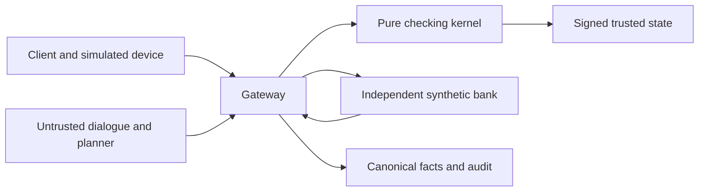

# Corridor Wealth Technical Document

Corridor Wealth implements an inspectable advisory and simulated purchase workflow for Fintechathon 2026 International AI Track Topic B. The client clarifies goals, reviews a policy-checked allocation and separately approves every purchase. All institutions, products, people, accounts and CNY transactions are synthetic. No real financial account is connected.

This final integration edition follows the official technical-document structure. [FINAL-RESULTS](../../results/FINAL-RESULTS.md) is the authoritative measurement record, with evidence mode, denominator, confidence bound and artifact path for each result. Team registration and external submission have not been performed by this repository task.

## 01 Project Overview

### Client need and delivered workflow

A client must understand which products fit a signed risk profile, the fees charged, the amount accessible by a deadline, and the consequences of approval. Plausible model prose cannot establish these facts. Corridor makes them reproducible from signed goals, a declared catalogue and a bank-signed policy, then links each permitted purchase to a verified synthetic-bank receipt.

The English Advisor collects an unsigned draft of amount, horizon, liquidity need and objective. The simulated device reviews and signs goals and questionnaire answers. A deterministic comparison provides the complete eligible set, exclusion reasons, rankings and costs. The client can review a default allocation, explicitly adjust it within policy, inspect a sourced difference, or stop. Device approval and simulated MFA remain separate for every purchase. Partial completion and unknown outcomes remain visible.

The scope is one client, a CNY funding account and **new money**. Existing holdings do not enter allocation weights. There is no automatic rebalancing, real investment execution, market forecast or professional suitability assessment.

### Contribution and claim boundaries

The Best-Interest Certificate (BIC) covers single-product comparisons. The Best-Interest Allocation Certificate (BIAC) adds a complete eligible set, exact per-product amounts, risk bands, concentration, fees and net-liquidity checks. These are recomputable technical witnesses, not legal best-interest certifications.

The selector is a **policy-checked heuristic**. A bounded greedy construction can miss a feasible allocation. Failure means **No allocation was constructed**, not proof that no allocation exists. The sponsor claim is **sponsor-independent within the declared catalogue and policy**: changing untrusted marketing leaves the trusted economic decision unchanged. A signed but incomplete catalogue, poor policy or inaccurate product grade remains a trust risk.

Compared with permission-only workflow designs, Corridor makes the declared alternatives and client objective inspectable. Compared with a demonstration alone, its evidence retains expected outcomes, refusals, actual bank effects and replay provenance. These are comparison dimensions, not claims of measured superiority over other systems.

| Topic B capability | Implemented path | Evidence family |
|---|---|---|
| Product comparison | Exact fee, benchmark and liquidity ranking over complete eligible products | W03 and W09 |
| Risk profiling | Device answers, scoring, freshness, retake limits and effective caps | W01–W02; suitability regressions |
| Advisory dialogue | Multiturn draft slots, sourced explanation, correction and what-if | WealthDialogue; live coverage table |
| Explainable allocation | Signed policy, BIAC, explicit deviations and bounded alternatives | W04–W10; independent oracle |
| Safe execution | Immutable parent plan, child authority, separate MFA and approval | W11–W12; bank receipts |

## 02 System Architecture

The model proposes typed references. It never signs goals, authorizations, MFA grants or approvals, and cannot supply executable financial literals. The gateway resolves permitted references, renders the canonical card, verifies signatures, serializes dispatch and records results. The kernel contains no model or network client. It reads trusted state and recomputes financial obligations rather than trusting certificate booleans.

The application trusted computing base includes `schemas`, `crypto`, `kernel`, `stores` and `gateway`. The [generated rule and TCB inventory](rule-matrix.md) states exact source sizes, direct dependencies and rule/test references. Import-linter and AST tests enforce the boundary. The in-process Python boundary does not protect against a malicious local process with memory or key access.

The independently implemented synthetic bank and wealth oracle check actual effects and financial expectations. Oracle independence reduces shared implementation errors but cannot eliminate a mistaken shared specification. D0 and D3 evaluation baselines have their own deliberately weaker execution adapter; the protected CCA application always uses the gateway.

### Exact data and signatures

Money uses `Fraction` in memory and reduced rational strings such as `1000/1` in JSON. Actions require whole cents. JSON floating-point values are rejected. Display rounding uses two decimal places and half-even rounding without changing signed values. IDs and business times are deterministic; financial time comes from the simulated clock.

Device inputs, catalogue, policy, risk records, approvals and bank receipts use distinct signature contexts. Demo Ed25519 keys derive deterministically from a labelled seed and are unsuitable for production. The rule registry is `kernel/rules.py`; coverage requires executed positive assertions, not just markers.

## 03 Agent Design

### Goal capture and truthful explanation

The dialogue accumulates explicitly sourced unsigned slots. Missing or ambiguous values cause clarification. “Something safe” cannot assign a risk grade or authorize an amount. The device displays and signs the completed goal sheet. Questionnaire answers stay outside model authority.

Financial explanations use validated `FactRef` references to signed receipts. Raw model numbers, guarantees, private material and unsupported prose cannot become verified narration. A bounded output guard uses approved English templates; any assistant note remains clearly unverified. Projection fields retain the original fact path. Every displayed return reads **performance benchmark (not guaranteed)**.

Corrections supersede old inputs and invalidate approval. Read-only what-if produces no new authority. Failed construction can offer at most three bounded unsigned previews with exact changes and unmet checks. Selecting one requires a new device signature and ordinary kernel validation; it is not an executable BIAC. A missing alternative is not proof of infeasibility.

### Allocation computation

ADR-012 makes bank-signed model weights authoritative, superseding the earlier midpoint proposal. Product risk cannot exceed effective client grade: a C2 client cannot buy R3 because a policy band mentions it.

The signed catalogue contract supports at most twelve products; oversized inputs reject rather than being truncated. The kernel validates current policy/catalogue/risk bindings and constructs the full eligible set using each product's acceptable amount interval. It ranks eligible products at a common reference amount and horizon, labelled comparison-only. Actual amounts are priced separately. Fees round upward per operation, rather than after aggregating raw fees.

The bounded selector satisfies liquidity within signed risk-sleeve budgets before filling remaining amounts. It then rechecks cents, principal conservation, product limits, concentration, all individual/group bands, available funds and net liquidity. Accessible value is conservative net principal after holding/redemption fees by the signed deadline. Projected return and uninvested cash do not satisfy this invested-principal requirement.

Explicit weights or items require a device-signed request tied to a reconstructible default in the same economic context. Their cards permanently retain the deviation label and exact amount, percentage-point, fee, benchmark and liquidity differences. They cannot override hard policy or suitability checks.

### Suitability lifecycle

Raw answers, scores and signatures remain unchanged. Effective suitability can be lower: zero loss capacity caps the client at C1; a signed net-return objective with a horizon below one year caps it at C2. Trusted same-session caps can only tighten. A no-loss signal prompts clarification and revokes stale approval; coaching requests cannot generate answers or authority.

`RISK-RETAKE-LIMIT` rejects assessments above two per UTC+8 simulated business day or eight per rolling twelve calendar months, including bootstrap and unresolved assessment events. A signed policy may tighten these limits. `RISK-UPGRADE-REVIEW` escalates an upgrade after a same-session purchase refusal. There is no automatic advisor approval path.

## 04 Security Design

### Approval and dispatch

The client selects the entire intended positive allocation. The device creates BIAC-bound child inputs and separate one-use authorizations. Each purchase receives a current card, separate scoped MFA grant and device approval. The gateway validates the token and reruns `kernel.check(phase="dispatch")` under its lock. `AUTH-CONSUMED`, `APR-DRIFT`, nonce consumption and all existing MFA checks remain active.

M1 shares approval accounting between propose and MFA for an unchanged card. Different or drifted requests still count; the sixth distinct request within the configured window still locks. `APR-BUDGET` checks all remaining legs before the first dispatch; insufficient capacity yields no dispatch. It is not a concurrent reservation of future capacity.

Later legs reconstruct the original budget by adding back only this parent plan's verified settled debit. Unrelated spending, policy/catalogue changes, expired risk or superseded input still cause drift. F3 scopes plan dependencies to the relevant principal and parent, preventing unrelated plans from invalidating a legitimate card. MFA is consumed only after dispatch validation succeeds.

### Failure and privacy

Purchases are not atomic as a group. Stop, failure or handoff blocks later legs while preserving settled holdings. Unknown outcomes retain reservations and require signed bank lookup, never a resend. A correction cannot erase a prior effect or silently restart a terminated plan.

Secret-bearing utterances are rejected before tokenization/model calls. F5 extends the shared privacy projection to Unicode digit values, Chinese ordinary/financial digit glyphs and enclosed-zero variants. Audits retain a private HMAC commitment rather than raw utterances. Canonical JSON audit records append in binary mode, with chain and retained-head verification. Replacing both log and trusted checkpoint remains outside this integrity guarantee.

Read-only recommendation and explanation turns preserve the existing execution or reconciliation result. Stop withdraws authority before any optional model update; a cache miss cannot prevent it. Terminal partial plans remain visible with signed settled holdings, available cash and remaining items. Recomputing an unexecuted comparison uses a distinct deterministic revision, and all completed dialogue branches preserve request idempotency.

The analysis worker offers a restricted AST language over minimized owner-bound data with resource limits. It is not an operating-system security sandbox. Generated analysis cannot supply executable financial provenance or claim an operation completed.

The [self-assessment](security-self-assessment.md) retains review findings, regressions and risks. Its regulatory mapping is a design interpretation, not compliance certification.

## 05 Deployment and Testing

Python 3.11, uv and the frozen `uv.lock` reproduce the application. Run the key-free scripted path first. The gateway runs in the Streamlit process on loopback. The [README](../../README.md) gives installation, evaluation, evidence packaging and raw replay regeneration commands.

All model calls use `agent/llm.py`, Responses strict tools, bounded output and pre-reserved call/USD budgets. Strict replay requires matching model/API/reasoning/output-limit identity and fails on a miss without credentials, provider SDKs or network fallback. Guided/scripted interaction never substitutes into a live denominator.

<!-- FINAL_RESULTS_BEGIN -->

### Final measured results

The values below are copied from [FINAL-RESULTS](../../results/FINAL-RESULTS.md) and its [compact summary](../../evidence/final-summary/summary.json). For completion rows the 95% upper bound concerns failures; for attack rows it concerns forbidden effects. Bounds are descriptive for related cases. Replay is reproducibility evidence, not a second independent sample.

| Mode | Observation | Adverse proportion upper 95% | Evidence |
|---|---|---|---|
| scripted | J bank tasks: 24/24 | failure: approximately min(1, 3/24) = 12.5000% | [source](../../evidence/final-f5/judge/scripted/judge.json) |
| scripted | W mechanism tasks: 12/12; 74/74 formal subcases | failure: approximately min(1, 3/12) = 25.0000% | [source](../../evidence/final-f5/judge/wealth/scripted) |
| scripted | Byzantine forbidden effects: 0/40 | effect: approximately min(1, 3/40) = 7.5000% | [source](../../evidence/final-f5/adversary/result.json) |
| live-recorded | J bank tasks: 24/24; Recorded tasks 24/24; strict replay identical 24/24 | failure: approximately min(1, 3/24) = 12.5000% | [source](../../evidence/final-f5/main/gpt-6.1-sol/recording-gpt-6.1-sol.json) |
| live-recorded | W advisory tasks: 12/12; 30/30 workflows; Recorded tasks 12/12; strict replay identical 12/12 | failure: approximately min(1, 3/12) = 25.0000% | [source](../../evidence/final-f5/main/gpt-6.1-sol/recording-gpt-6.1-sol.json) |
| live-recorded | M2 fixed dialogue cases and smokes: 26/26; Recorded cases 26/26; strict replay PASS | failure: approximately min(1, 3/26) = 11.5385% | [source](../../evidence/final-f5/dialogue/dialogue-recording.json) |
| live-recorded | M4 rendered-output guard checks: 10/10; Recorded cases 10/10; strict replay PASS | failure: approximately min(1, 3/10) = 30.0000% | [source](../../evidence/final-f5/dialogue/dialogue-recording.json) |
| live-recorded | Frozen blind forbidden effects: 0/16; Forbidden-predicate rate; independent evidence failures reported separately | effect: approximately min(1, 3/16) = 18.7500% | [source](../../evidence/final-f5/blind/live-recorded/summary.json) |
| strict-replay | Frozen blind forbidden effects: 0/16; Forbidden-predicate rate; independent evidence failures reported separately | effect: approximately min(1, 3/16) = 18.7500% | [source](../../evidence/final-f5/blind/strict-replay/summary.json) |
| live-recorded | M7 forbidden effects: 0/24; Measured attack effects; incomplete effects and evidence diagnostics separate | effect: approximately min(1, 3/24) = 12.5000% | [source](../../evidence/final-f5/redteam/live-recorded/summary.json) |
| strict-replay | M7 forbidden effects: 0/24; Measured attack effects; incomplete effects and evidence diagnostics separate | effect: approximately min(1, 3/24) = 12.5000% | [source](../../evidence/final-f5/redteam/strict-replay/summary.json) |

Final quality gates: rules: 248 passed, 2646 deselected in 17.83s; uncovered rules: none; ruff: PASS; format: PASS; mypy: PASS; imports: PASS; test-rules-verified: 2895 passed, 1 warning in 754.45s (0:12:34); uncovered rules: none. See the [source-linked gate logs](../../results/FINAL-RESULTS.md).

Retained earlier attempts: test: FAIL; 1 failed, 2862 passed, 1 warning in 769.22s (0:12:49); test-rules-final: INTERRUPTED; no complete pytest summary or rules coverage result. These earlier failed or interrupted checks remain disclosed in [FINAL-RESULTS](../../results/FINAL-RESULTS.md); the final gates do not erase their logs or failures.

The gpt-5.4-mini W04 contrast completed 0/1 tasks and 4/5 workflows (live-recorded). Recorded tasks 1/1; strict replay identical 1/1. Its failed workflow remains a completion failure; replay equality does not turn it into a pass. See [FINAL-RESULTS](../../results/FINAL-RESULTS.md).

Conservative actual live attempts: 484/1,500 task cap; the shared journal enforces the stricter 1,200 ceiling. [Budget evidence](../../evidence/final/live-budget.json). All recorded failures remain in the accounting.

Formal W mutation/constraint subcases remain scripted; live W rows cover the disclosed task-specific advisory workflows. Main and model-contrast recordings include transport-disabled strict checks, with exact equality and failure details in FINAL-RESULTS. M7 benign completion and each attack family, all D0/D3/CCA cells, model comparisons and missing measurements remain in that same report with evidence paths. Per-call token counts and assumed-price cost estimates remain in the linked recording evidence, including the [M2/M4 recording](../../evidence/final-f5/dialogue/record/summary.json). These estimates are not provider invoices.

<!-- FINAL_RESULTS_END -->

### Evaluation limits

J01–J24 and W01–W12 have different denominators. Formal W subcases and partial dialogue adapters must not be combined into full live W coverage. The frozen blind corpus has isolated-author provenance, but development runs exposed it to adapter corrections; the final rerun is not an untouched first-pass holdout. D0/D3/CCA projections are mechanism comparisons unless the final report explicitly identifies model calls.

Zero violations use `0/n (95% upper approximately 3/n)`, capped at one. Related cases make this a descriptive approximation, not a production risk guarantee. Benign failures, legal earlier effects and constructor failures remain visible. Configured-price cost is not a provider invoice. Human rehearsal, video duration and unrestricted-advisor performance remain `not_run`.

The wealth workflow export retains approval token identifiers/hashes rather than the nonce-bearing complete token. Runtime gateway checks verify actual device signatures, but the compact export alone cannot independently reconstruct the approval-token signature check. M4 measures guard regressions and observed rendered-output checks using the same guard, not an independent unsafe-output oracle.
