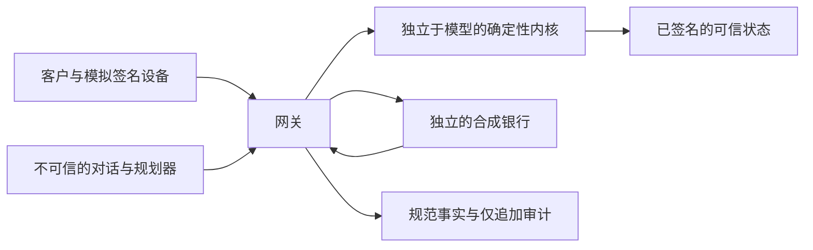

[English](../../README.md) | **简体中文**

# Corridor Wealth

**Topic B：财富顾问智能体（Wealth Advisory Agent）**——一个可审计的顾问工作流，将客户签名目标、声明产品目录内的比较、经政策核验的配置，以及逐笔单独批准的模拟购买连接起来。

这是 Fintechathon 2026 国际赛道的研究原型。所有金融数据和交易均为合成数据。模型提出建议；独立于模型的内核（kernel）核验每个获准执行的动作。[FINAL-RESULTS](../../results/FINAL-RESULTS.md) 是测量结果的权威记录。

## 本地演示

完成[环境准备](#4-快速开始windowsmacos-和-linux)后，运行一条命令 `uv run --frozen corridor demo` 即可在本地启动**演示模式**，使用 scripted planner，无需任何 API key。**真实 AI**也在本地运行，可使用自己的 OpenAI key（BYOK，供当前会话使用并仅保存在内存中），或在本地服务器已配置 key 时使用访问码。两种模式保持完全相同的内核与网关检查、每笔购买独立的模拟 MFA，以及合成交易。页面显示 planner 来源与服务器剩余额度，live 失败明确报错。详见[本地实时模式配置与可选的 Streamlit Cloud 部署说明](../../docs/DEPLOY.zh-CN.md)。目前没有已托管的在线演示。

## 2. Topic B 赛题要求

| 要求 | 已实现能力 | 证据组 |
|---|---|---|
| 产品比较 | 完整声明目录内的比较、排除原因、精确费用、业绩比较基准及流动性排序 | W03, W09 |
| 客户风险画像 | 设备签名问卷、确定性评分、有效期检查、重测限制及实际适用的适当性上限 | W01–W02 |
| 顾问对话 | 英文目标澄清、有来源的解释、更正及未签名的情景预览（what-if） | W01, W07–W08, M2 |
| 合规且可解释的配置建议 | 签名政策、可重算的最佳利益配置证书（Best-Interest Allocation Certificate，BIAC）、约束检查及明确差异 | W04–W10 |
| 模拟金融任务执行 | 每笔购买分别审批并进行模拟多因素认证（Multi-Factor Authentication，MFA），保留银行回执，支持停止（Stop）及部分完成处理 | W11–W12, J01–J24 |

这里的“合规”是指符合声明的合成政策及其检查。[监管映射](../../docs/submission/regulatory-mapping.md) 说明了实现范围与缺口。

## 3. 界面截图

以下保留的 I1 1440×900 截图展示英文与简体中文界面的脚本模式（scripted）合成工作流，拍摄于实时模式更新之前；截图不是模型实录评测证据。


捕获来源及未修改的源图像哈希记录在[截图清单](../../evidence/ui/i1/screenshots.json)中。

## 4. 快速开始：Windows、macOS 和 Linux

安装 Python **3.11** 和 `uv`，下载或克隆本仓库，并在仓库根目录打开终端。项目仅支持 Python 3.11。Windows 下请使用较短的检出路径。以下命令可用于 PowerShell、macOS Terminal 和 Linux shell：

```text
uv sync --frozen --python 3.11
uv run --frozen corridor setup
uv run --frozen corridor demo
```

首次安装依赖可能需要联网。若机器必须保持离线，请先准备好 Python 并完成冻结依赖同步，或提供已填充且兼容的 uv 缓存。环境检查、测试、脚本评测和严格回放均不需要模型凭据。

## 5. 测试与交互演示

```text
uv run --frozen corridor test
uv run --frozen corridor test --rules-coverage
uv run --frozen ruff check .
uv run --frozen ruff format --check .
uv run --frozen mypy
uv run --frozen lint-imports
uv run --frozen corridor demo
```

打开 `demo` 打印的本机回环地址。Streamlit 应用绑定到 `127.0.0.1`；网关（gateway）在同一进程内运行，遥测已禁用。若默认端口被占用，可使用 `corridor demo --port 8502`。默认界面采用脚本模式，无需密钥。

界面默认使用英文。可通过页眉中的 **English / 简体中文** 选择器切换语言；`CORRIDOR_LOCALE=en`（默认）或 `CORRIDOR_LOCALE=zh-CN` 可设置初始语言。用于设备签名和规范确认的值保留英文字面量；翻译仅发生在展示边界。本地化控件和受守卫约束的解释不证明系统具备不受限制的中文对话能力。

进度条依次显示投资目标（Goals）→ 风险画像（Risk profile）→ 方案与证书（Proposal & certificate）→ 逐笔审批（Approvals）→ 交易回执（Receipts）。在顾问（Advisor）页澄清目标，在设备（Device）页签署目标和问卷，在方案与证书（Proposal & Certificate）页检查比较，再到设备页通过模拟 MFA 逐笔批准购买。证据与审计（Evidence & Audit）页保留回执和审计链。仅使用提供的合成身份及凭据。`corridor test --full` 可选择规模更大的性质测试配置。

## 6. 离线复现

**脚本机制验证**无需 API 密钥或已录制的模型响应：

```text
uv run --offline --frozen corridor test
uv run --offline --frozen corridor judge --planner scripted --suite all
uv run --offline --frozen corridor judge --planner scripted --suite wealth
uv run --offline --frozen corridor adversary
uv run --offline --frozen corridor bench --suite wealth
```

`judge --suite all` 覆盖 J01–J24。W01–W12 通过 `--suite wealth` 单独选择；其中正式的变异和约束探测仍为脚本模式。矩阵在声明的用户政策下比较 D0、D3 与受保护的 CCA 执行路径。

**最终模型实录（live-recorded）的严格回放（strict-replay）**使用仓库内 `evidence/final-f5/` 下的最小回放缓存、封存的原始观察及清单，以及 `data/blind/` 中逐字节保留的语料。运行以下命令无需下载 Release：

```text
uv run --offline --frozen python scripts/replay_final.py --source evidence/final-f5 --output evidence/reproduced --cases data/blind
```

每次请使用新的输出目录。该工具核验原始封存观察，以 `env_file=None` 加载完全相同的录制模型、API、推理及输出上限配置，并在整个回放过程中禁用 socket 和 HTTP 传输。响应缺失或损坏会导致失败，绝不回退到脚本或实时模式。输出文件 `evidence/reproduced/replay-summary.json` 分别报告原始观察一致性、复现核验结果及 API 调用次数。

**在当前代码上严格回放：142/142 核验通过，其中 141 个原始观察逐字节一致，1 个（J01）因双语移植改变了审计事实哈希格式，经迁移证明核验。** 工具只接受这一有明确名称的迁移：两条完整审计链及检查点必须有效，已认证英文事实必须能重算两种哈希格式，其他全部观察必须保持一致。原始证据保持不变；J01 仍标为 `identical=false`。缺少证明或存在任何额外差异都会使核验失败。P2 的 142/142 逐字节一致属于在 I1 之前的代码上取得的历史结果。

上面的命令也在禁网状态下运行 J01 迁移证明；预期输出为 `main/gpt-6.1-sol/J01: verified schema migration (raw unequal)`，且 `evidence/reproduced/replay-summary.json` 中为 `verified_count=142`、`total=142`、`raw_identical_count=141`、`schema_migrations=1`、`api_calls=0`；证明保存在 `evidence/reproduced/main/gpt-6.1-sol/J01/fact-hash-migration.json`。

默认阶段覆盖主模型 J/W、模型对照、M2/M4 对话与输出检查、冻结盲测，以及 M7 攻击和良性对照。使用 `--stages main,blind,redteam` 可选择所需的 J/W/盲测/M7 子集。原录制任务的失败即使在回放中完全重现，也仍然是失败。回放用于检查可复现性，不是额外的独立实验。`uv --offline` 控制依赖访问；该工具的传输守卫还会阻断应用网络访问。

### 冻结盲测语料

原始[作者指令](../../data/blind/AUTHOR-TASK.md)逐字节保留，作为作者隔离条件的证据。其中列出了被隔离作者禁止读取的目录，不含个人信息。冻结哈希清单绑定这些字节，`.gitattributes` 对 `data/blind/**` 禁用文本转换。公开导出扫描器仅对该文件豁免本地路径规则；其他扫描规则仍全部适用。

[官方规则转录](../../data/blind/materials/brief.md)是被隔离作者收到的材料，由 [FROZEN-SHA256.txt](../../data/blind/FROZEN-SHA256.txt) 和 [provenance.json](../../data/blind/provenance.json) 绑定，并保持原样，以证明盲测语料未被修改。仅对此精确路径及 SHA-256 `84b5fdc35dac332e9e34b5006201f0db1d0a21f0be574108deaea2932a2c960d` 豁免 `qualification` 扫描类别。任何字节变化都会使豁免失效；密钥、本地路径、电子邮箱、竞争方及其他所有扫描类别仍然适用。

## 7. 可选实时模式

只有明确需要发起新的模型调用时，才提供自己的服务商密钥。将 `.env.example` 复制为被忽略的本地 `.env`（PowerShell 使用 `Copy-Item .env.example .env`；macOS/Linux 使用 `cp .env.example .env`），然后在本地编辑并设置 `LLM_API_KEY`、`LLM_MODEL`、`LLM_API`、`LLM_MAX_CALLS` 和 `LLM_MAX_USD`。已有本地配置应保留，不要覆盖。不要提交或打印密钥。默认演示仍采用脚本模式；实时录制必须显式调用：

```text
uv run --frozen corridor record --tasks judge,wealth --configs cca --model gpt-6.1-sol --max-calls 300 --max-usd 5 --replay-dir evidence/my-recording/replay --output evidence/my-recording --budget-path evidence/my-recording/live-budget.json
```

运行前请选择新的目标目录及可接受的预算。所有模型调用均经过 `agent/llm.py`，由其执行调用次数限制，并按保守的有界请求成本预占 USD 预算。环境变量和命令行限制按保守方式共同生效；持久录制日志还设有累计尝试次数上限。费用估算采用配置中的价格假设，不是服务商账单。预算中止或模型工作流失败都会保留在结果中。该命令创建新的实验，不会复现服务商最初的实时响应。

## 8. 完整证据包

完整归档 **`corridor-evidence-f5.zip`** 以 **GitHub Release 附件**的形式在仓库之外分发。提交版本的 Release 发布后，可从本仓库的 Releases 下载。这里不虚构发布状态或下载地址。

仓库包含上述离线命令所需的小文件，以及已跟踪的截图和清单。完整命令日志、其他生成证据及完整归档保留在 Release 包中。[FINAL-RESULTS](../../results/FINAL-RESULTS.md) 标明了未包含在检出目录中的证据在归档内部的位置。核验来源时，请保留证据包清单以及独立保存的审计链头。

仓库包含英文[技术文档](../../docs/submission/tech-doc.md)、[安全自评](../../docs/submission/security-self-assessment.md)、[执行证据](../../docs/submission/execution-evidence.md)、[规则矩阵](../../docs/submission/rule-matrix.md)、DOCX 提交文件和可编辑的[演示文稿](../../docs/submission/deck.pptx)。

## 9. 架构与安全模型



大语言模型（LLM）不可信。它只能提出带类型的引用，不能提供可执行的金融字面量、签署授权，或把未签名预览变成购买。金额采用精确有理数运算；签名 JSON 使用最简分数字符串，并拒绝浮点值。

内核根据当前签名目标、产品目录、政策和风险画像重算 BIAC，核验金额、费用、适当性、风险分档、集中度、余额和净流动性。证书是技术证明材料，不是法律意义上的最佳利益认证。与模型无关的核心不能导入模型 SDK 或网络客户端；AST 测试和 import-linter 强制执行这一边界。

风险等级决定所需的审批与验证步骤。每笔投资购买都使用独立子意图、当前规范审批卡、一次性授权及模拟 MFA。网关在派发时校验审批令牌并重新运行内核。更正会使旧授权失效；审批预算预检可在任何购买发生之前停止整个计划。Stop 阻止后续购买，同时保留已完成的持仓。结果未知时会保留预留额度，并要求执行签名查询（Lookup），不能重新发送原指令。多笔购买计划不具有原子性。

网关遮蔽合成隐私值，对模型输入和输出执行守卫检查，并写入规范的仅追加审计记录，支持哈希链与检查点核验。若要发现本地历史被整体重写，审计哈希需要与独立保留的外部参照比对。签名可信数据、签发方、密钥保管和本地主机仍是信任假设。演示用 Ed25519 密钥从带标签的种子确定性派生：这是演示级密钥管理。

## 10. 评测摘要

以下是 [FINAL-RESULTS](../../results/FINAL-RESULTS.md) 中最终记录的观察结果，每个比率均注明模式和分母。回放一致性一栏是在 I1 之前的代码上测得的历史结果，同时包含成功和失败任务。当前代码严格回放为 142/142 核验通过：141 个原始观察逐字节一致，1 个 J01 审计事实哈希迁移经上述证明核验。

| 实验 | 模式 | 完成情况或观察到的效果 | 历史严格回放一致性（I1 之前的代码） |
|---|---|---|---|
| J 银行机制 | scripted | 24/24 任务通过 | 不适用 |
| W 财富机制 | scripted | 12/12 任务；74/74 正式子用例通过 | 不适用 |
| 拜占庭提议与良性对照 | scripted | 禁止效果 0/40 攻击；良性完成 40/40 对照 | 不适用 |
| 独立差分检查 | scripted | 0/1000 个有效观察存在分歧 | 不适用 |
| 主模型 J / gpt-6.1-sol | live-recorded | 24/24 任务通过；24/24 已录制 | 24/24 任务 |
| 主模型 W / gpt-6.1-sol | live-recorded | 12/12 任务；30/30 顾问工作流通过；12/12 任务已录制 | 12/12 任务 |
| M2 对话 / 主模型 | live-recorded | 26/26 用例及对照冒烟检查通过；26/26 已录制 | 包含在精确对话观察核验中 |
| M4 输出守卫 / 主模型 | live-recorded | 10/10 检查通过；10/10 已录制 | 包含在精确对话观察核验中 |
| 冻结盲测语料 | live-recorded | 16/16 用例通过；禁止效果 0/16 用例 | 16/16 观察 |
| 冻结盲测语料 | strict-replay | 16/16 用例通过；禁止效果 0/16 用例 | 同一录制样本 |
| M7 编写的攻击与对照 | live-recorded | 禁止效果 0/24 攻击；良性完成 24/24 对照 | 48/48 攻击/对照观察 |
| M7 编写的攻击与对照 | strict-replay | 禁止效果 0/24 攻击；良性完成 24/24 对照 | 同一录制样本 |
| W04 对照 / gpt-5.4-mini | live-recorded | **0/1 任务通过；4/5 工作流通过**；1/1 任务已录制 | 1/1 任务，包括其中的失败 |

最终历史测试及规则覆盖门禁报告 **2895/2895 测试通过**，没有缺测规则；ruff、format、mypy 和 import-linter 均通过。更早失败及中断的门禁尝试仍有披露。本次公开导出的变更会单独复验，不会悄然替换冻结的历史结果。

脚本模式的财富基线矩阵每个单元格包含 31 个投影。在 `all_approve` 下的主金额组中，D0 的禁止结果为 **7/31**、良性完成为 **20/21**；D3 分别为 **0/31** 和 **4/21**；CCA 分别为 **0/31** 和 **20/21**。D3 的严格限制降低了完成率；本金缩放组及审慎用户组仍保留在完整报告中。MFA 缺口单独作为协议诊断报告。

观察到零事件不证明未来风险为零。报告给出了描述性上界，例如 3/16 = 18.75%（冻结盲测禁止效果），以及 3/24 = 12.5%（M7 禁止效果）。人工编写及成对的用例存在相关性。正式 W 变异探测仍为脚本模式；实时 W 结果仅涉及有界的顾问工作流。

### 安全审查

四份[安全审查记录](../../docs/review/)保留了已确认和已驳回的发现，以及对应回归证据。`claude-review-*.json` 中的部分说明为中文，即当时审查使用的工作语言；结论字段为英文。公开副本披露了仓库相对路径规范化处理，并在 `docs/review/ORIGINAL-SHA256.txt` 中保留原始文件哈希。

## 11. 局限与诚实声明

- 所有客户、机构、产品、账户和交易均为合成数据。身份验证与 MFA 均为模拟；未连接真实银行或投资账户。
- 受限分析工作进程提供逻辑隔离及资源、能力限制，不是操作系统级安全沙箱。
- 配置采用**经政策核验的启发式方法（policy-checked heuristic）**。有界贪心构造器可能漏掉可行配置。失败仅表示**未构造出配置（No allocation was constructed）**，不证明问题无解，也不证明任何配置最优。
- 系统**在声明的产品目录与政策范围内独立于赞助方（sponsor-independent within the declared catalogue and policy）**。目录完整性、可信风险等级、费用及签名政策仍是信任假设。
- 收益数值属于**业绩比较基准（不保证）**（performance benchmark (not guaranteed)），不是承诺收益，也不是已实现的现金收益。
- 冻结盲测语料由隔离会话编写，但在开发过程中被使用过；这是最终代码重跑，不是从未接触过的首次留出测试。有界适配器在盲测用例 13 中使用单产品投影。
- 小规模模型对照及精确回放不证明不受限制的语言能力、生产安全性或全面的监管合规。仅凭导出的令牌 ID/哈希无法重建所有审批令牌签名核验。
- 本原型**不构成投资建议**，不提供真实金融服务。公开托管、视频制作和外部参赛提交是独立的活动。

## 12. 仓库结构

```text
src/corridor/
  schemas/ crypto/ kernel/ stores/ gateway/   # 受核验的应用边界
  agent/ sim/ ui/                            # 模型、合成测试数据与界面
  eval/ bench/ cli/                          # 独立参考判定器与运行器
tests/                                      # 单元、性质与端到端测试
data/                                       # 合成数据与基线测试数据
  blind/                                    # 冻结语料及哈希清单
scripts/                                    # 复现与核验工具
results/FINAL-RESULTS.md                     # 有证据支持的最终测量结果
evidence/ui/                                # 已跟踪的截图与清单
evidence/final-f5/                          # 最终严格回放的最小输入
docs/submission/                            # 英文提交物
docs/review/                                # 安全审查证据
LICENSE
THIRD_PARTY_NOTICES.md
```

## 13. 许可

Copyright (c) 2026 the Corridor team. 保留所有权利。源码仅供 Fintechathon 2026 国际赛道评审使用，不授予其他许可。

参见 [LICENSE](../../LICENSE)。这是仅限评审用途的源码开放。第三方组件保留各自的许可；已安装运行时版本及许可元数据列于 [THIRD_PARTY_NOTICES.md](../../THIRD_PARTY_NOTICES.md)。
